# 📥 Social Media Downloader Bot

A Telegram bot for downloading media from your favorite social media platforms, plus scraping TikTok profiles — all directly inside Telegram.

The bot supports downloading videos and media from **Facebook, YouTube, TikTok, Instagram, Snapchat, Pinterest, Jaco, Likee, and Twitter (X)**, and can also scrape TikTok profiles to fetch their content.

## ✨ Features

- 📥 **Multi-Platform Downloads** — Download media from Facebook, YouTube, TikTok, Instagram, Snapchat, Pinterest, Jaco, Likee, and Twitter (X).
- 🎬 **YouTube Support** — Fetch and download videos from YouTube links.
- 📸 **Instagram Support** — Download posts, reels, and media from Instagram.
- 🎵 **TikTok Support** — Download TikTok videos with ease.
- 👤 **TikTok Profile Scraping** — Scrape TikTok profiles to fetch their content.
- 🐦 **Twitter (X) Support** — Download media from Twitter (X) posts.
- 📌 **Pinterest Support** — Download pins and media from Pinterest.
- 👻 **Snapchat Support** — Download media from Snapchat.
- 🎭 **Likee & Jaco Support** — Download content from Likee and Jaco.
- 🤖 **Full Telegram Integration** — Send a link and get your media back, right in the chat.
- ⚡ **Fast & Simple** — A smooth, straightforward download flow for a great user experience.

## 📸 Screenshots

  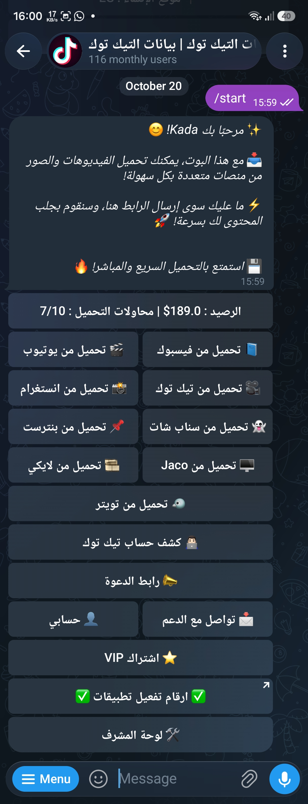
  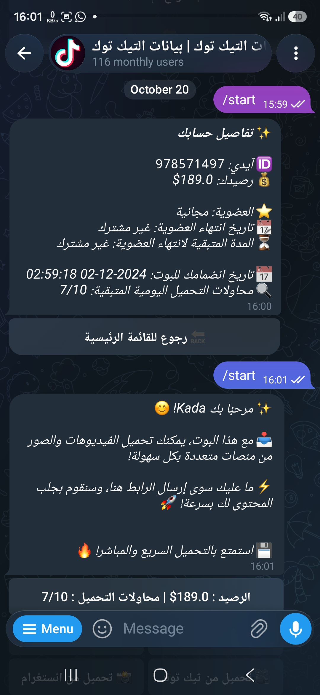
  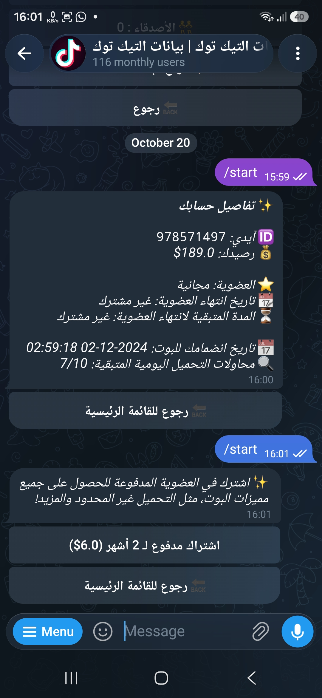

  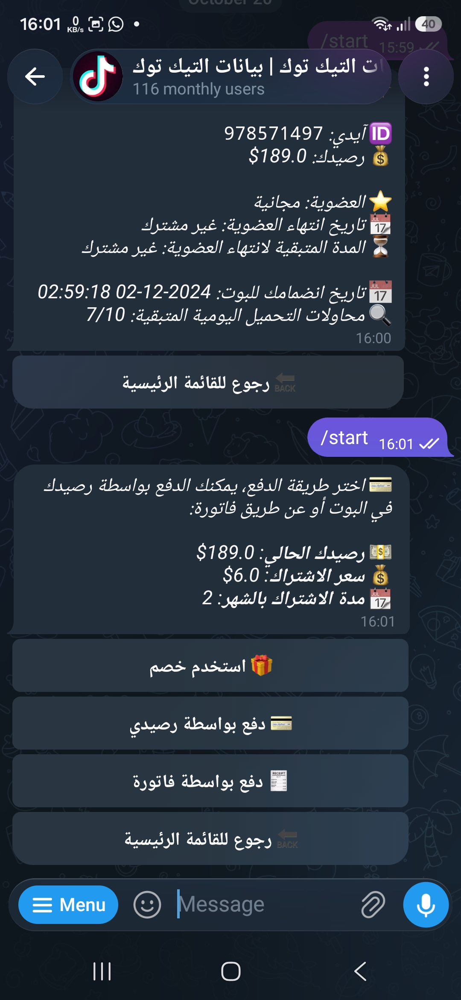
  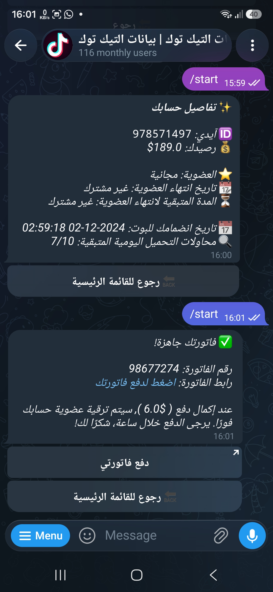
  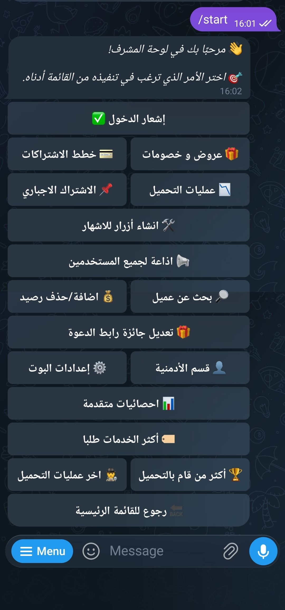

  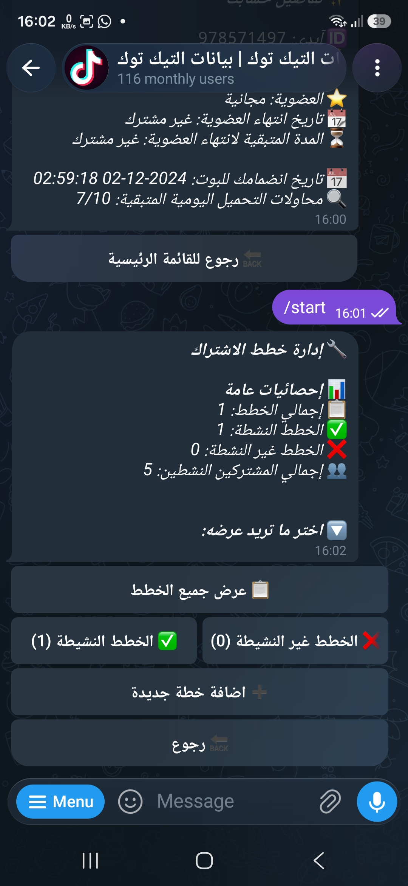
  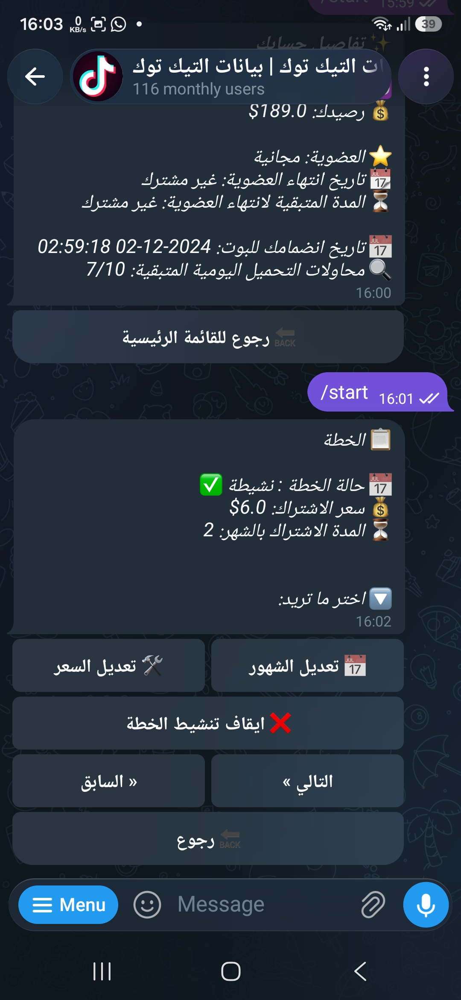
  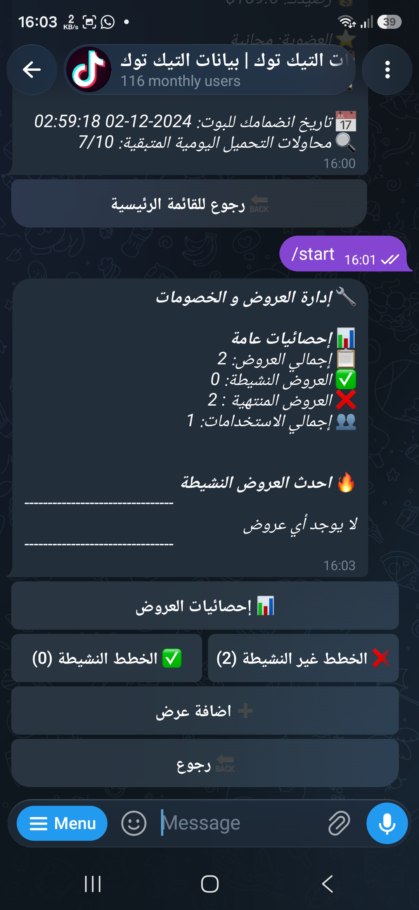

  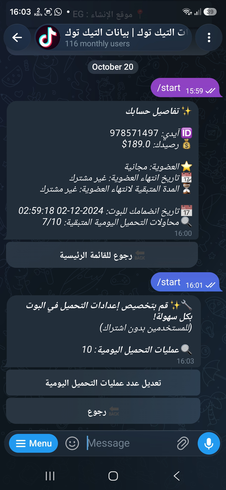
  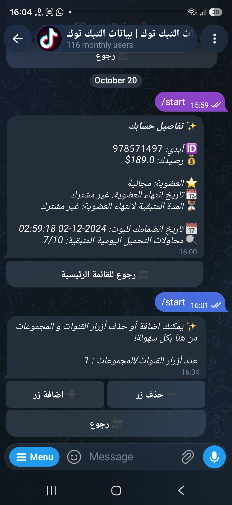
  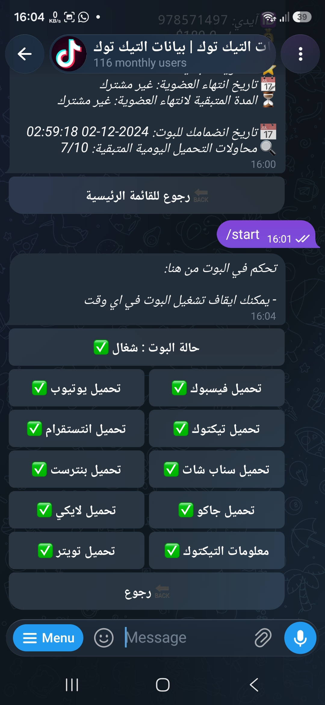

  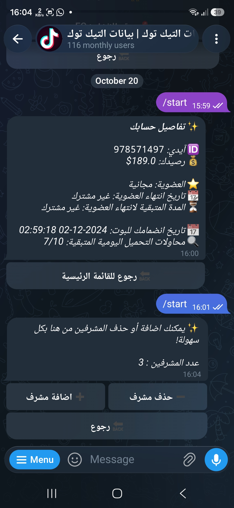
  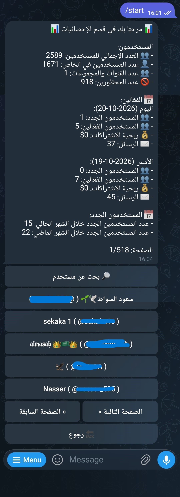
  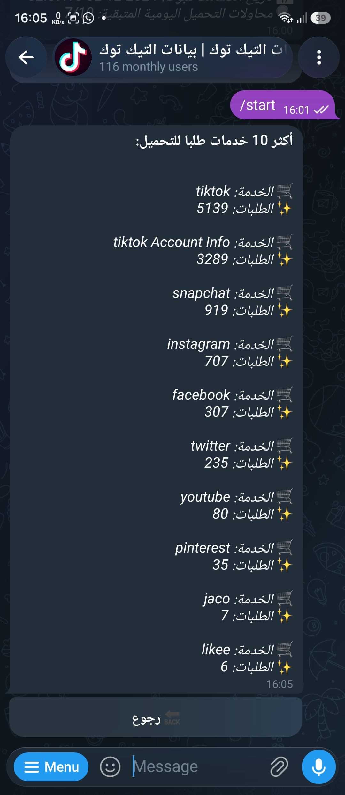

  
  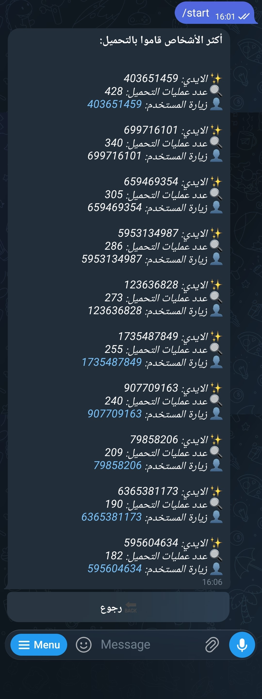
  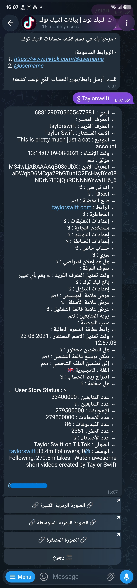

  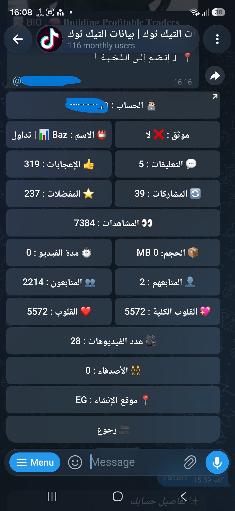

